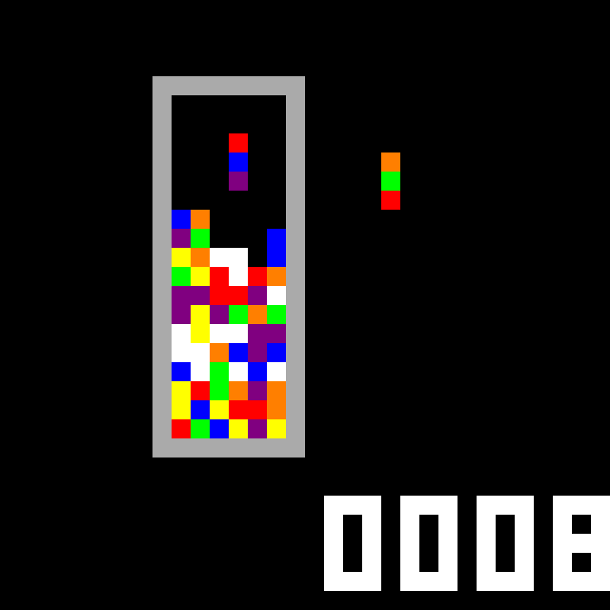
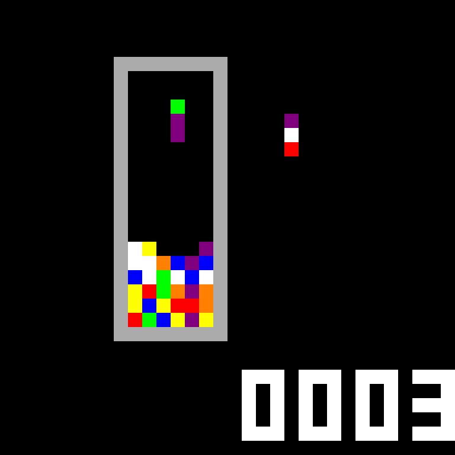

# Columns MIPS

A falling-gem Columns game written in MIPS assembly by Akshar for a CSC258 final project. Arrange matching gems in vertical, horizontal, or diagonal lines. The source includes a next-column preview, difficulty selection, scoring, increasing gravity, pause, a landing outline, and white special gems.

## Screenshots



| Gameplay | Pause screen |
| --- | --- |
|  |  |

Captured from the actual MARS framebuffer using scripted gameplay in a temporary capture copy. Images are enlarged with nearest-neighbor scaling; the original assembly remains unchanged. [Capture details](screenshots/README.md).

## Recovered original

`Columns_Game.asm` is the exact recovered attachment: **60,703 bytes, 3,035 logical lines**. It ends with `j game_loop` without a final newline, so `wc -l` reports 3,034. No source edits, reformatting, or compatibility patches were applied. `.gitattributes` disables Git line-ending conversion for this file. See `SHA256SUMS` and [validation](docs/VALIDATION.md).

## Run with MARS 4.5

1. Install Java if needed (`java -version` should work). Download the executable JAR from the [official MARS release page](https://github.com/dpetersanderson/MARS/releases). Launch with `java -jar /path/to/Mars4_5.jar`.
2. Open `Columns_Game.asm`. Enable extended/pseudo instructions, use the default memory configuration, and **disable delayed branching**. Assemble the program.
3. Open **Tools → Bitmap Display**, set the values below, and click **Connect to MIPS**.
4. Open **Tools → Keyboard and Display MMIO Simulator**, and click **Connect to MIPS**.
5. Run at maximum simulator speed. Focus the keyboard simulator's input area and press **1**, **2**, or **3** to start. The program waits for this key before drawing the board; an initially blank display is expected.

| Bitmap setting | Value |
| --- | --- |
| Unit width / height | 8 / 8 pixels |
| Display width / height | 256 / 256 pixels |
| Base address | `0x10008000` |

The framebuffer contains 32 × 32 words (4,096 bytes). Keyboard status is read at `0xffff0000`, and key data at `0xffff0004`. Input goes through MMIO, not the Run I/O console.

## How to play

1. Start the program. The initial black screen is waiting for a difficulty selection.
2. Press `1` for Easy, `2` for Medium, or `3` for Hard.
3. Move the falling column with `a`, `s`, and `d`; press `w` to cycle its three gem colors.
4. Form lines of **three or more matching gems** horizontally, vertically, or diagonally. Matches flash white and disappear; gems above them fall into the gaps and may create further matches.
5. Use `e` to briefly preview the landing position, and watch the next-column preview on the right. Press `p` to pause or resume.
6. Keep the stack below the top of the board. When the game ends, the pixel-art **Game Over** message flashes four times.
7. Press `1` on the game-over screen to retry, then select a difficulty again. Press `q` to quit. See the documented retry-position limitation below.

## Features

- **Automatic gravity:** the active column falls without input. Gravity speeds up as matches are cleared.
- **Three difficulties:** Easy, Medium, and Hard start at progressively faster speeds and use score multipliers of 1×, 2×, and 3×.
- **Pixel score display:** the score is drawn directly into the bitmap display.
- **Next-column preview:** the upcoming three gems appear to the right of the board.
- **Landing outline:** `e` briefly shows where the active column will land.
- **Pause screen:** `p` suspends play and displays a pixel-art message; press it again to continue.
- **Clear animations:** matched cells flash white before disappearing. Special clears also flash the marked row or column.
- **White special gems:** three matching white gems horizontally clear the whole row; three vertically clear the whole column. White gems are not wildcards for arbitrary colors.
- **Game-over animation and retry:** the board is replaced by a flashing message, with options to retry or quit.

### Scoring and progression

Each clearing pass adds **the number of marked cells × the selected difficulty multiplier** to the score. For an ordinary three-gem match, that is 3 points on Easy, 6 on Medium, or 9 on Hard. Special row/column clears mark the entire line, including empty cells, so those marked empty cells also count in the current implementation.

Every five clearing passes increases the level and reduces the gravity interval. A chain reaction can contribute several clearing passes. Initial gravity intervals are 65, 50, and 35 game-loop iterations for Easy, Medium, and Hard; each loop includes a 16 ms sleep plus processing time. Timing therefore varies with simulator performance.

## Course milestones and attribution

Created by **Akshar** for the **CSC258 Assembly Final Project**. The author's project summary reports completion of **Milestones 1–5**. Detailed feature descriptions were supplied for Milestones 4 and 5:

| Milestone | Category | Implemented features |
| --- | --- | --- |
| 4 | 3 easy features | Automatic gravity; increasing gravity speed; difficulty selection |
| 4 | 1 hard feature | Pixel score display with difficulty-based scoring |
| 5 | 4 easy features | Pixel game-over screen; pause/resume screen; landing outline; next-column preview |
| 5 | 2 hard features | Clear/game-over animations; white special gems that clear a row or column |

Feature numbering in the original course handout: Milestone 4 easy **1, 2, 3**, hard **1**; Milestone 5 easy **4, 6, 7, 10**, hard **3, 6**. These completion statements are author-provided, rather than an independently checked course assessment.

## Controls

Use lowercase letters.

| Key | Action |
| --- | --- |
| `1` / `2` / `3` before play | Easy / medium / hard |
| `a` / `d` | Move left / right |
| `s` | Move down one step |
| `w` | Cycle gem colors: bottom gem moves to the top |
| `e` | Briefly show the landing outline |
| `p` | Pause; press `p` again to resume |
| `q` during play | Quit |
| `1` after game over | Retry, then choose difficulty again |
| `q` after game over | Quit |

While paused, the input loop only handles `p`; use the simulator Stop control if needed. For a clean new game, reset/reassemble the simulator; see the retry limitation below.

## Saturn troubleshooting

See [compatibility notes](docs/COMPATIBILITY.md). The recovered file is ordinary UTF-8 assembly and assembles in MARS. The exact cause of the reported Saturn open/run failure has not been reproduced. Saturn's inspected development implementation supports the required system calls and keyboard MMIO, so claiming that Saturn inherently lacks these features would be incorrect.

## Validation

The original assembled successfully with official MARS 4.5. A bounded original run reached the expected startup wait. An explicitly instrumented temporary copy is used for a 120-frame smoke test; it selects easy difficulty automatically and exits after the test. It does not change the preserved original or prove interactive gameplay works.

To repeat the checks with your own official MARS JAR:

```sh
python3 tools/smoke_test.py /path/to/Mars4_5.jar
shasum -a 256 -c SHA256SUMS
```

Known source issue: `restart_game` resets board, score, counters, and colors but does not reset `active_x` / `active_y`. A retry may inherit the previous column position. This is documented and left unchanged.

## Project contents and publishing

- `Columns_Game.asm`: preserved original source.
- `docs/`: recovery, validation, and simulator compatibility findings.
- `tools/smoke_test.py`: reproducible, isolated MARS smoke test.
- `SHA256SUMS`: original source integrity record.

Suggested GitHub repository name: **columns-mips**. Upload this folder's contents to a new repository. No remote repository has been created. No license has been chosen on the author's behalf; add a license if you want to grant reuse rights.
